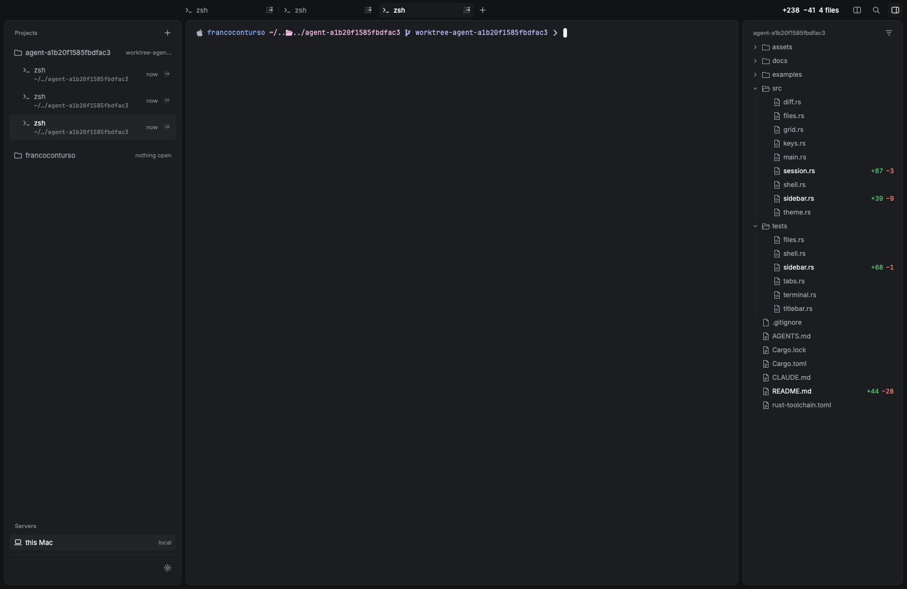

# contr-rune

A small port of [contr](https://github.com/contursofran/contr) to [Rune](https://github.com/anomalyco/rune),
a GPU-rendered Rust UI framework. It is built from **rune-kit** components on rune-kit's neutral theme.
It is an experiment to see how Rune compares with GPUI and MyGo for this kind of app, not a replacement
for contr.



- **Sidebar:** each project with its current git branch, and its terminals under it. A terminal row
  shows its title, the folder it is in, a spinner while it prints, and how long it has been quiet
  (`now`, `14m`, `2h`). Hover a project to get a `+` that opens a terminal there. The head `+` opens
  another folder as a project. A "Servers" section sits below.
- **Tabs:** the selected project's terminals in a `TabStrip`, with a close button and a `+`.
- **Terminal:** a real login shell in a PTY, parsed by `alacritty_terminal` and drawn as coloured text
  rows. Scrollback with the wheel or Shift+PageUp/PageDown. A tab closes when its shell exits.
- **Title bar:** the diff summary of the project (`+added −removed`, files changed), a split button,
  search and the files panel toggle.
- **Split:** the Split button or ⌘D puts a new terminal of the same project on the right of the current one
  (a tab and a sidebar row too); the button shows pressed. The focused pane has a soft outline; keys,
  paste, Shift+PageUp and find go to it. Click a pane or press ⌘[ / ⌘] to focus it; the selected tab and
  sidebar row follow, and selecting another tab shows it in the focused pane. Drag the divider to resize
  (each pane keeps 20%). Split again or ⌘D un-splits: the focused pane takes the panel and the other terminal
  stays as a tab. Closing a pane's terminal (⌘W, or its shell exiting) un-splits too. One split, side by side.
- **Find:** the Search button or ⌘F opens a floating bar at the top right of the terminal. Typing
  highlights every match of the word (plain text, any case) in the scrollback and screen; the count
  reads "3 of 12". Return / ⌘G go to the next match, Shift+Return / ⌘⇧G to the previous, wrapping; the
  view scrolls to it. Esc closes the bar. Another tab closes it.
- **Files panel:** the project's git tree (`.gitignore` respected) with a state per file, a "changed
  only" filter, and opening a file uses the default app (`open` on macOS, `xdg-open` on Linux).

## Run

```sh
cargo run                                     # projects: the current folder and home
CONTR_PROJECTS=~/proj-a:~/proj-b cargo run    # or pick your own
```

Rust 1.99.1 (pinned in `rust-toolchain.toml`). On Linux, Rune needs `libxkbcommon` and `wayland`
at build time. Rune is pre-release, so `Cargo.toml` pins a commit of its `dev` branch.

## Keys

| Keys (Linux) | macOS | Action |
|---|---|---|
| Ctrl+Shift+T | ⌘T | New tab in the selected project |
| Ctrl+Shift+W | ⌘W | Close tab |
| Ctrl+Shift+B | ⌘B | Show or hide the files panel |
| Ctrl+Shift+, | ⌘, | Open settings (Esc closes) |
| Ctrl+Shift+D | ⌘D | Split the terminal in two, or un-split (the Split button too) |
| Ctrl+Shift+[ / ] | ⌘[ / ⌘] | Focus the left / right pane |
| Ctrl+Shift+F | ⌘F | Find in the terminal (the Search button too); Esc closes the bar |
| Enter / Ctrl+Shift+G | Return / ⌘G | Next match (in the find bar; F3 too) |
| Shift+Enter / Ctrl+Alt+Shift+G | Shift+Return / ⌘⇧G | Previous match (Shift+F3 too) |
| Ctrl+Tab | Ctrl+Tab | Next tab |
| Ctrl+Shift+Tab | Ctrl+Shift+Tab | Previous tab |
| Ctrl+PageDown / Ctrl+PageUp | same | Next / previous tab |
| Ctrl+Shift+V | ⌘V | Paste (bracketed when the program asks) |
| Shift+PageUp / PageDown | same | Scroll back |

Everything else, Ctrl keys included, goes to the shell.

## Appearance

Settings (the gear at the foot of the sidebar, or the key above) has an Appearance choice: System,
Dark or Light. System follows the OS appearance live; Dark and Light are `Kit::neutral(true)` and
`Kit::neutral(false)`, and the whole app, terminal included, switches without a restart. The choice is
kept in `~/Library/Application Support/contr-rune/settings.json` on macOS and
`$XDG_CONFIG_HOME/contr-rune/settings.json` (default `~/.config`) elsewhere; a missing or broken file
means System. `CONTR_SETTINGS=<file>` uses another file.

## Check without a window

Rune renders headless, so the UI can be checked without opening a window:

```sh
cargo test                                                           # unit and integration tests
cargo run -- --snap out.png --size 1710x1112 --scale 1 --scene three-tabs --at 4   # render to PNG
cargo run -- --tree tree.json --scene three-tabs                     # the element tree with bounds, as JSON
cargo run -- --script script.json --tree tree.json --scene three-tabs  # click, hover and keys, then the tree
```

- `--scene` picks a fixed state: `three-tabs` (three shells in the first project) or `ansi` (colour demo).
- `--at <seconds>` waits before the shot, so the shells have printed their prompt.
- A script is `{"events": [{"t": 0.5, "type": "tap", "key": "term-1"}, ...]}`. Elements have stable
  keys such as `tab/0`, `project-0`, `term-1` and `add-0`; `tests/` shows more.

## Layout

| File | What |
|---|---|
| `src/main.rs` | State, the title bar, tabs and terminal views, keys and shortcuts |
| `src/sidebar.rs` | The sidebar: projects, branch, terminal rows, servers |
| `src/session.rs` | A shell in a PTY; a reader thread feeds `alacritty_terminal`; row subtitle |
| `src/grid.rs` | The emulator's visible grid to text rows with colour spans and the cursor |
| `src/keys.rs` | Rune key events to xterm byte sequences |
| `src/diff.rs` | `git diff` summary and change list for the title bar and the files panel |
| `src/files.rs` | The files panel data: git tree, change state, open with the default app |
| `src/shell.rs` | The window shell: title bar and three panel cards (shared with `examples/kit_preview.rs`) |
| `src/theme.rs` | Sizes, type styles and fonts |
| `tests/` | Headless integration tests (`--script` and `--tree`) for each part |
| `docs/design/` | The design target, the build order (`PARTS.md`) and snapshots per part |

## Not built

- Text selection and copy, and mouse reporting to programs inside the terminal.
- Split (the button is there, with no action).
- Measured cell width: it assumes 0.6 em, which fits JetBrains Mono and DejaVu Sans Mono.
- herdr (`hc`) agents: these are plain shells. Projects are not saved between launches.
